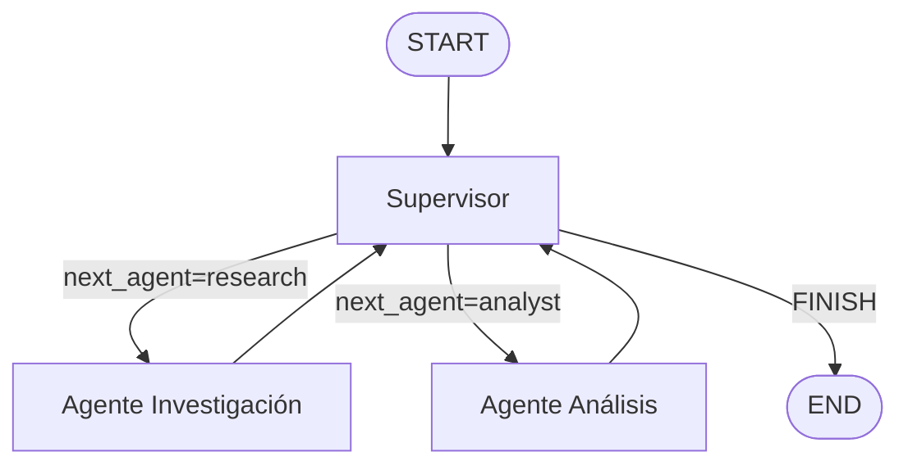

# Orquestador Multi-Agente Especializado

Prototipo funcional de un sistema jerárquico de agentes usando **LangGraph** con modelos reales de **Gemini**.

## Topología Elegida

**Jerárquica con Supervisor central** (Router + Controlador de flujo).

- El **Supervisor** es el único punto de decisión. Evalúa el estado actual y decide qué especialista debe intervenir o si la tarea está completa.
- Los agentes especialistas (**Research** y **Analyst**) no se comunican entre sí directamente. Siempre regresan al Supervisor.
- Esto evita contaminación de contexto y permite trazabilidad clara.

### Diagrama del Grafo (Mermaid)



## Manejo de Conflictos y Bucles

- **Contador de iteraciones** (`iteration_count`) con límite (`MAX_ITERATIONS = 6`).
- El Supervisor usa un LLM de Gemini con una **rúbrica de suficiencia**:
  - Sin `research_data` → Research
  - Con research pero sin `analysis_result` → Analyst
  - Ambos presentes y de calidad suficiente → FINISH
- Cada contribución se registra en `contributions` para auditoría.
- Manejo robusto de respuestas de Gemini (cuando `content` llega como lista en lugar de string).

## Estructura del Repositorio

```
├── state.py                 # Esquema TypedDict (AgentState)
├── main.py                  # Grafo + Supervisor + ejecución
├── requirements.txt
├── .gitignore
├── agents/
│   ├── __init__.py
│   ├── research_agent.py    # Agente de búsqueda (LLM + tool)
│   └── analyst_agent.py     # Agente de análisis (LLM)
└── README.md
```

## Modelos

Se usan **modelos reales de Gemini** (`gemini-1.5-flash`) vía `langchain-google-genai`.

### Requisitos

1. Obtén una API key de Google AI Studio: https://aistudio.google.com/app/apikey
2. Exporta la variable:

```bash
# Linux / Mac
export GOOGLE_API_KEY="tu-api-key-aqui"

# Windows (CMD)
set GOOGLE_API_KEY=tu-api-key-aqui

# Windows (PowerShell)
$env:GOOGLE_API_KEY="tu-api-key-aqui"
```

3. Instala dependencias:

```bash
pip install -r requirements.txt
```

### Ejecución

```bash
python main.py
```

### Ejemplo de Consulta

> "Analiza el estado actual del mercado de inteligencia artificial y da un sentimiento general."

Flujo esperado:
1. Supervisor → Research (obtiene datos)
2. Supervisor → Analyst (procesa y sintetiza)
3. Supervisor → FINISH

## Herramientas

- **Research**: `search_web` (simulada; fácilmente reemplazable por `TavilySearchResults`).
- **Analyst**: Razonamiento directo del LLM (sentimiento, métricas y síntesis).

## Estado Compartido

Ver `state.py`. Campos clave:
- `research_data`, `analysis_result`: outputs de especialistas
- `contributions`: trazabilidad de qué agente aportó qué
- `next_agent`, `task_completed`, `iteration_count`: control de flujo
- `validation_feedback`: decisiones del supervisor

## Extensiones Posibles

- Integrar Tavily real (`TAVILY_API_KEY`)
- Añadir más agentes (Writer, Validator, etc.)
- Persistencia con Postgres o Redis en lugar de `MemorySaver`
- Añadir streaming de respuestas
